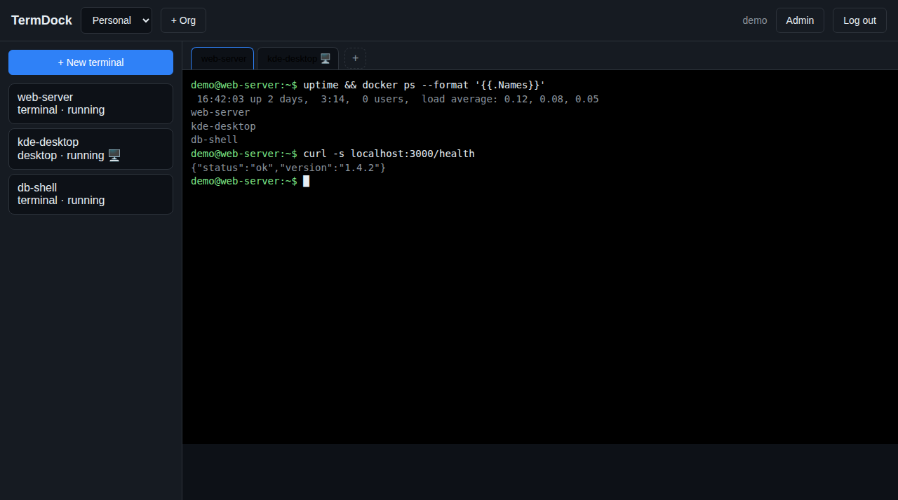
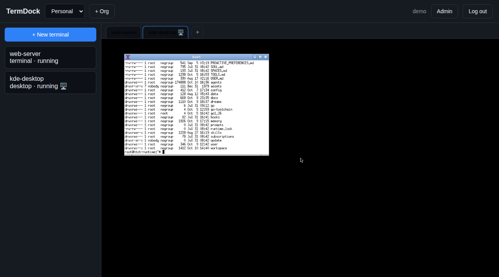
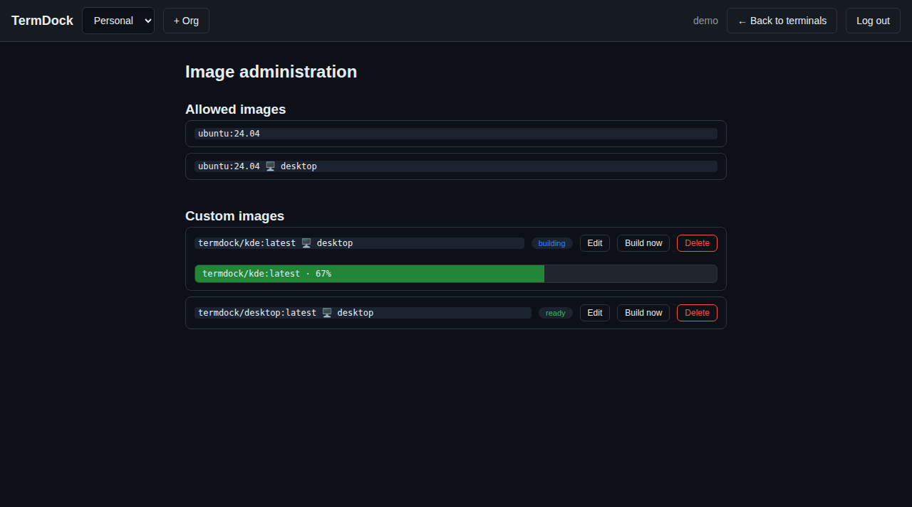

# TermDock

TermDock is a "coder-like" service: open a web page, click **New terminal**, and
the backend launches a Docker container behind the scenes. When the container
is ready, an interactive terminal is pushed to the page — xterm.js over a
websocket, attached to a real shell inside the container. Open as many
terminals as you want; stopping or deleting a session spins its container down.

Multi-user and multi-tenant: users belong to **organizations**; sessions live
in an org. Any session can additionally be **shared** with individual users as
**viewer** (read-only stream) or **collaborator** (interactive), and access can
be revoked at any time — a revoked user's terminal window closes immediately.

## Quickstart

Prerequisites: a host with Docker (or Podman — see below).

```bash
docker compose up --build -d
# open http://<host>:8080 — register the first user (it becomes admin)
```

### Podman

Point TermDock at the Podman socket — Podman's Docker-compatible API covers
everything TermDock uses (images, containers, volumes, networks, exec):

```bash
TERMDOCK_DOCKER_HOST=unix:///var/run/podman/podman.sock ./termdock
```

or with compose, mount the Podman socket at the usual path:

```yaml
volumes:
  - /var/run/podman/podman.sock:/var/run/docker.sock
```

That's it. Distribution and upgrades are a single self-contained binary: the
whole frontend is embedded with `go:embed`, so at runtime the binary needs
nothing but the SQLite data dir and the Docker socket — no `static/`
directory, no companion files.

```bash
# build the binary directly (needs Go 1.26+)
go build -o termdock ./cmd/termdock
TERMDOCK_DATA=./data ./termdock
```

## Using it

- **New terminal**: pick a name, org, image, shell, CPU / memory limits, and
  idle timeout. The image is a dropdown of admin-approved images (see below).
  The session shows `starting…` while the image pulls and the container
  starts; the tab attaches automatically when it is `running`.
- **Admin: image management**: admins get an **Admin** button in the header.
  - **Allowed images**: the dropdown list users pick from. Seeded with the
    configured default image on first run; admins can add/remove entries.
    Non-admins can only run allowed images (or custom-image tags); admins
    keep free choice via a "Custom…" entry.
  - **Custom images**: define a Dockerfile (e.g. baking in Zot); it becomes
    `termdock/<name>:latest`. When a session requests it and no cached image
    exists, TermDock builds it automatically during provisioning (status
    shows `building`); otherwise the cached image is reused. A "Build now"
    button pre-builds in the background, with status shown in the list.
- **Multiple terminals per container**: the **+** button in the tab bar opens
  another tab with its own shell (`docker exec`) in the active tab's
  container — tabs are labeled `name`, `name (2)`, `name (3)`, …. The sidebar
  keeps listing containers, one row each. The first ("main") terminal is
  persistent: closing its tab only detaches, and its shell restarts if it
  exits. Extra terminals are ephemeral: their shell is torn down when the
  last viewer leaves or the shell exits. Viewers can only watch the main
  terminal; collaborators may open extra ones.
- **Pop out**: every terminal tab has a **⧉ Pop out** button that opens the
  session in a standalone popup window (`/t/{id}`) — the popup shows a tab
  strip with all of the container's terminals (same `name` / `name (2)` / …
  labels as the dashboard) plus a **+** button for new shells, so the popup
  mirrors the container's full tab set. The popup uses the same attach
  websocket and the same authorization as the dashboard.
- **Share**: the Share button on a tab lets you grant another user `viewer`
  (watch-only) or `collaborator` (interactive) access, list grants, and
  revoke them. Viewers see a "View only" banner and their keystrokes are
  ignored.
- **Stop / Resume / Delete**: Stop removes the container but keeps the
  `/workspace` volume; Resume recreates the container with the same volume
  (fresh shell, files intact). Delete removes the container *and* the volume.

### Lifecycle guarantees

- **Closing a browser tab or popup window only detaches the websocket.** It
  never stops or deletes the session, never kills the container, never kills
  the shell. The session stays in the dashboard list with live status;
  reopening re-attaches to the same running shell. The backend keeps the
  `docker exec` alive even with zero viewers, and replays the last 64KB of
  output to the next attacher so you never land on a blank screen.
- **Idle timeout** stops a session only when *all three* hold for
  `idle_minutes`: no attached viewers, no PTY output activity, and no input.
  A build still spewing output is not idle. Idle stop removes the container
  but **keeps the volume** — your files survive; running processes do not.
  Only files persist across a stop; processes never do.

## Configuration

All config is environment variables:

| Variable | Default | Meaning |
|---|---|---|
| `TERMDOCK_ADDR` | `:8080` | Listen address |
| `TERMDOCK_DATA` | `./data` | Directory holding `termdock.db` |
| `DOCKER_HOST` | `unix:///var/run/docker.sock` | Docker daemon (standard `DOCKER_*` env also honored) |
| `TERMDOCK_DOCKER_HOST` | _(unset)_ | Override for the container runtime socket; takes precedence over `DOCKER_HOST`. A bare path like `/var/run/podman/podman.sock` is accepted (treated as a unix socket) — the `unix://` prefix is optional |
| `TERMDOCK_REG_OPEN` | `true` | Allow self-registration (`false` disables `/api/auth/register`) |
| `TERMDOCK_DEFAULT_IMAGE` | `ubuntu:24.04` | Default image for new sessions |
| `TERMDOCK_IDLE_DEFAULT` | `60` | Default idle timeout in minutes (`0` = never) |
| `TERMDOCK_SECURE_COOKIE` | `false` | Set the session cookie `Secure` flag (enable behind TLS) |

## Architecture

```
browser ──websocket──> TermDock (single Go binary)
                            │  one `docker exec -it <shell>` PTY per session
                            │  (hub: broadcast output, input only from collaborators)
                            ▼
                       Docker daemon ──> container per session
                                         (sleep infinity + exec'd shell,
                                          /workspace volume, termdock network)
```

### Why an exec-hub instead of gotty/ttyd per container

Running gotty/ttyd inside every container would mean modifying images (or
wrapping entrypoints), punching a port per session, and re-implementing auth
in each one. Instead the backend holds a single interactive `docker exec` PTY
per running session and multiplexes it to browser websockets:

- **No image modification** — any image works, including minimal ones (the
  shell falls back from `/bin/bash` to `/bin/sh` when bash is missing).
- **Central auth** — the cookie session is checked on the HTTP upgrade and
  per-share roles are enforced in one place; viewers get a read-only stream.
- **Sharing is socket management** — broadcast output to N sockets, accept
  input only from collaborators, close sockets on revoke.
- **One container, one main process** (`sleep infinity`); the shell is just an
  exec. If the shell exits, the hub restarts it after 1s (a few retries, then
  it tells the client to reopen the tab).

Containers are unprivileged, join an isolated `termdock` bridge network, get
no published ports, and are capped with NanoCPUs, a memory limit, and
`PidsLimit: 1024`. Each session gets a named volume mounted at `/workspace`
(working dir), labeled `termdock.session=<id>` / `termdock.managed=true` so
boot reconciliation can adopt or park containers after a restart.

### Status badges (OSC 133 shell integration)

Every terminal shows a status pill in its toolbar:

- gray `○ waiting for input` — the shell is at a prompt
- green pulsing `● running 1:23` — a command is executing, with elapsed time
- red `✗ exit 1` flash (or subtle `✓`) right after a command finishes
- the popup window's `document.title` mirrors it (`(● 0:42) my-term`), so the
  OS taskbar shows live state; the dashboard session list shows a matching
  activity marker.

How it works: when the session's shell is **bash**, the backend injects two
env vars into the docker exec — `PROMPT_COMMAND=__td_done` and a
`BASH_FUNC___td_done%%` function — so bash emits
`\x1b]133;D;<exitcode>\x07` after every command (the same protocol VS Code
uses). The shared frontend module (`web/static/terminal.js`, used by both the
dashboard tabs and the `/t/{id}` popup) strips these sequences before writing
to xterm and drives the state machine: `starting → waiting → running`
(optimistically on Enter) `→ waiting` on the next D sequence.

Fallbacks: **non-bash shells** skip the injection and use an output-activity
heuristic (running if output arrived in the last 3 seconds, else waiting). If
an image's `~/.bashrc` overrides `PROMPT_COMMAND`, the D sequences never
arrive and the terminal silently degrades to the same heuristic.

### Latency design

The terminal path is built for minimal latency:

- PTY bytes travel as **binary websocket frames in both directions** —
  keystrokes go out as raw bytes, never wrapped in JSON/base64.
- **permessage-deflate is never enabled** on the terminal socket (compression
  adds flush latency to every frame).
- The Go hub forwards PTY output to viewers **immediately — no batching, no
  ticker**. Each viewer has a bounded non-blocking queue; a viewer that falls
  behind is dropped rather than blocking the broadcast.
- The client calls `term.write()` immediately on every message (no
  `requestAnimationFrame` batching), sends keystrokes immediately, and the
  OSC-133 strip parser is streaming O(n) with no added buffering.
- Rendering tries the **WebGL renderer addon** (`xterm-addon-webgl`) for
  heavy-output performance, with automatic fallback to the canvas renderer if
  WebGL fails or the context is lost.
- PTY resize propagation from the browser is debounced (~120ms) so a
  drag-resize doesn't hammer the Docker exec-resize API; the backend resize
  path itself does a single `ContainerExecResize` per event.

### Transport

WebSocket is the v1 transport, but the terminal hub never sees it: every
attached client is a small `Stream` interface (`Read` / `WriteBinary` /
`WriteText` / `Close`, in `internal/hub`), and the gorilla websocket upgrade
plus adapter live in `transport_websocket.go`. If TermDock ever needs to go
worldwide, WebTransport over QUIC can be added as a second `Stream`
implementation — the hub, the sharing/revoke logic, and the frontend protocol
(binary data frames, JSON control frames) stay untouched.

## API sketch

All `/api/*` (except `POST /api/auth/register` and `POST /api/auth/login`)
require the `termdock_session` cookie.

- `POST /api/auth/register {username, password}` → 201 (first user = admin;
  every user gets a personal org so sessions work immediately)
- `POST /api/auth/login`, `POST /api/auth/logout`, `GET /api/auth/me`
- `POST /api/orgs {name}`, `GET /api/orgs`
- `POST /api/orgs/{id}/members {username, role}` (owner/admin),
  `GET /api/orgs/{id}/members`, `DELETE /api/orgs/{id}/members/{userID}`
  (owner/admin; the last owner can't be removed)
- `POST /api/sessions {name, org_id, image?, shell?, cpu?, memory_mb?, idle_minutes?}` → 201, then `creating → pulling → running`
- `GET /api/sessions?org_id=`, `GET /api/sessions/{id}`
- `POST /api/sessions/{id}/start`, `POST /api/sessions/{id}/stop`,
  `DELETE /api/sessions/{id}` (creator or org owner/admin)
- `GET /api/sessions/{id}/attach` → websocket (org member = collaborator;
  share grant = grant role; an explicit grant **overrides** org membership, so
  an org member can be downgraded to viewer on one session)
- `POST /api/sessions/{id}/shares {username, role}`,
  `GET /api/sessions/{id}/shares`,
  `DELETE /api/sessions/{id}/shares/{shareID}` (revoke closes their sockets)

## Security notes

- **Run behind TLS.** The app itself serves plain HTTP; put Caddy (or nginx)
  in front:

  ```caddy
  termdock.example.com {
      reverse_proxy 127.0.0.1:8080
  }
  ```

  Then set `TERMDOCK_SECURE_COOKIE=true` so the session cookie gets the
  `Secure` flag. Cookies are `HttpOnly`, `SameSite=Lax`.
- Containers are unprivileged with CPU/memory/PID limits and no published
  ports, but anyone who can create sessions gets code execution as the
  container user on the Docker host's network — treat session creation as a
  privileged capability and put it behind your org membership.
- Private registries (e.g. zot): the daemon uses the Docker host's own
  `~/.docker/config.json` for pulls; the app additionally reads
  `DOCKER_CONFIG`/`~/.docker/config.json` and passes per-registry auth on
  `ImagePull`. Mount a read-only config into the app container if needed (see
  `docker-compose.yml`).
- Passwords are bcrypt-hashed; auth tokens are 256-bit random hex, 30-day
  expiry, purged lazily.

### Auth roadmap (planned, not built)

Later, auth may be terminated at a reverse proxy doing OAuth, with the proxy
passing the authenticated user in a trusted header (e.g. `X-Forwarded-User`).
The code is structured for this: session resolution lives in one place
(`auth.Handler.Authenticate` / the `RequireAuth` middleware, `UserFromContext`
for handlers), so a future env-gated proxy-auth mode can substitute header
trust for cookie validation. The trust rule will be: **only honor the header
from the proxy** (bind the app to localhost / internal network and never
expose it directly). This build is local accounts only.

## Development

```bash
# toolchain: ~/go1.26/go/bin/go, GOCACHE=~/workspace/.gocache
export PATH=~/go1.26/go/bin:$PATH GOCACHE=~/workspace/.gocache
go build ./... && go vet ./... && gofmt -l . && go test ./...
```

The VM used for development has no Docker daemon, so container operations
can't be live-tested there — unit tests cover access resolution
(`internal/access`), the websocket hub with a fake PTY (`internal/hub`),
including broadcast gating, binary input, resize gating, revoke, ring-buffer
replay, and the input-activity callback.

## Roadmap

- Multi-host: schedule sessions across several Docker hosts
- OIDC / proxy-auth mode (see above)
- Share links (token URLs for view-only streaming without an account)
- Per-org image allowlists and default resource quotas

## Showcase

<video src="docs/showcase/demo.mp4" controls width="100%"></video>

### Dashboard — terminal sessions


### Desktop sessions via VNC


### Admin — live build progress

